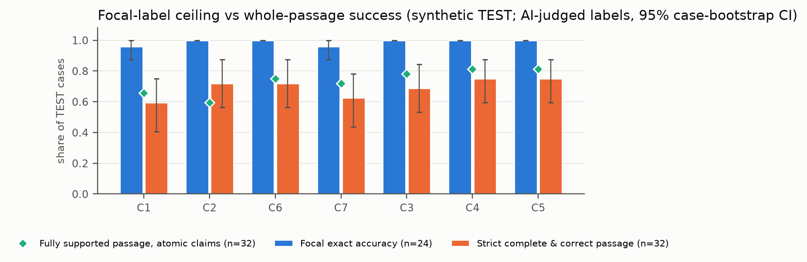
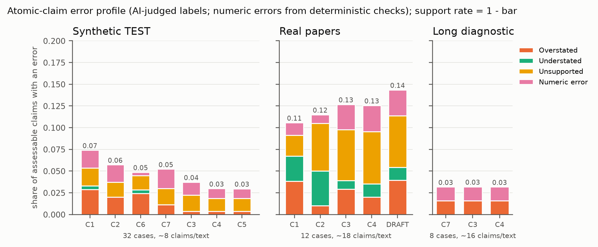
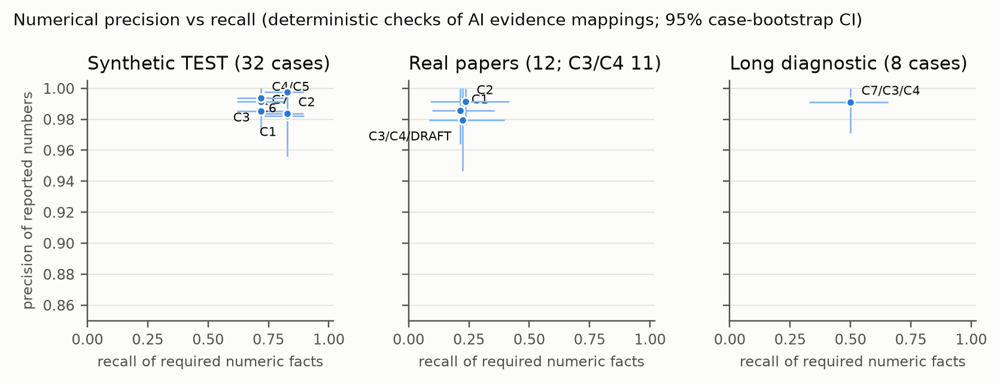
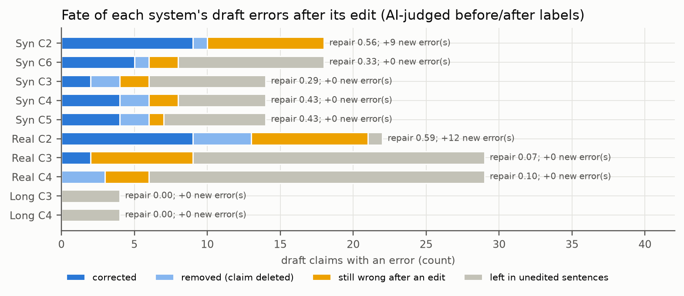
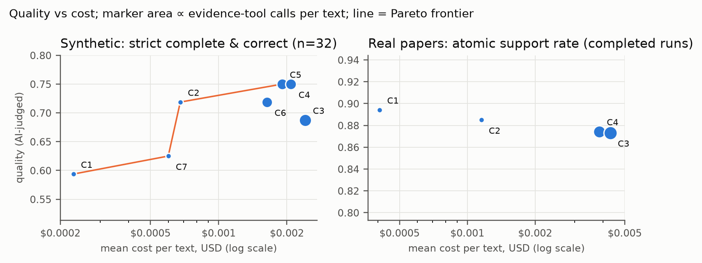

# Evaluation Extension: Results (AI-judged, exploratory, post-freeze)

> **Read this first.** Every label in this document was produced by AI models: two judge families (OpenAI GPT-5.6
> via the Codex CLI; Anthropic Claude Sonnet 5.5 or Haiku 5.5 via the Claude CLI) and an AI adjudicator. Numeric
> correctness was checked by deterministic code on AI-produced evidence mappings. **No human annotated or validated
> anything here.** Agreement figures are AI–AI consistency, not human inter-annotator reliability. The metrics were
> designed after the frozen TEST evaluation and after the first AI-scored results, in response to tutor feedback;
> they are exploratory and were not pre-registered. Protocol and its dated amendments:
> `docs/EVALUATION_EXTENSION_PROTOCOL.md`. Machine-readable results: `results/ai_extended/`.

## Summary of main findings

The headline comparison is between direct generation (C1), the generic writer–reviewer loop (C2), scripted
verification (C3) and the full adaptive agent (C4). The ablations C5–C7, the long-package stress test and the
judge-reliability analyses (§6, §10, §11) are supplementary. Generated by `evaluation/extended_report.py`
(`results/ai_extended/tables/main_table.md`):

| Synthetic TEST (32 cases) | C1 direct | C2 writer–reviewer | C3 scripted verifier | C4 full agent | C4 − C2 [95% CI] |
|---|---|---|---|---|---|
| Focal exact accuracy (24 ordinal cases) | 0.958 | 1.000 | 1.000 | 1.000 | +0.000 [+0.000, +0.000] (degenerate) |
| Strict complete-and-correct passage | 0.594 | 0.719 | 0.688 | 0.750 | +0.031 [-0.094, +0.156] |
| Atomic claim support rate | 0.926 | 0.943 | 0.963 | 0.970 | +0.027 [-0.009, +0.063] |
| Atomic factual error rate | 0.074 | 0.057 | 0.037 | 0.030 | -0.027 [-0.063, +0.009] |
| Fully supported passage | 0.656 | 0.594 | 0.781 | 0.812 | +0.219 [+0.000, +0.438] |
| Numeric precision | 0.982 | 0.984 | 0.991 | 0.994 | +0.010 [-0.008, +0.032] |
| Numeric recall (64 required facts) | 0.828 | 0.828 | 0.719 | 0.719 | -0.109 [-0.185, -0.033] |
| Cost per passage (USD) | 0.00023 | 0.00068 | 0.00241 | 0.00209 | — |
| Evidence-tool calls per passage | 0.0 | 0.0 | 12.9 | 9.2 | — |

| Real papers (12; C3/C4 completed on 11) | C1 direct | C2 writer–reviewer | C3 scripted verifier | C4 full agent | C4 − C2 [95% CI] |
|---|---|---|---|---|---|
| Atomic claim support rate | 0.894 | 0.885 | 0.873 | 0.874 | +0.005 [-0.068, +0.086] |
| Atomic factual error rate | 0.096 | 0.100 | 0.122 | 0.116 | +0.002 [-0.074, +0.066] |
| Finding recall (package checklist) | 0.376 | 0.412 | 0.487 | 0.474 | +0.077 [-0.045, +0.200] |
| Negative/null-finding recall | 0.179 | 0.256 | 0.417 | 0.417 | +0.194 [+0.027, +0.375] |
| Numeric precision | 0.986 | 0.991 | 0.979 | 0.979 | -0.012 [-0.048, +0.019] |
| Numeric recall (checklist facts) | 0.215 | 0.237 | 0.224 | 0.224 | -0.035 [-0.102, +0.025] |
| Cost per passage (USD) | 0.00041 | 0.00115 | 0.00431 | 0.00385 | — |

* Five of seven systems reach perfect focal accuracy, but strict whole-passage success ranges from 0.59 to 0.75.
* **C4 does not establish an advantage over C2** in claim accuracy or passage-level success, and keeps fewer of the
  required numbers (numeric recall −0.109 [−0.185, −0.033]). Its one clear advantage, recall of negative or null
  findings on real papers, comes from the shared outline draft, not from verification. Under a 2-of-3 majority of three AI judge families the support difference
  is −0.004 [−0.048, +0.036].
* Verification helps a little against its own draft on synthetic cases, almost not at all on real papers, and not at
  all on the long packages. Few correct claims are damaged, but most errors stay in place.
* **STRENGTHEN never occurred**, so H2 could not be tested; the verifiers behave as overstatement and number checkers.
* Real-paper passages have a claim error rate of 0.10–0.13 (synthetic: 0.03–0.07) and report under half of the
  important findings; the outline-based systems report more negative or null findings than C1 and C2.
* Adaptive checking (C4) matches scripted checking (C3) at lower cost: an efficiency result.
* All labels are AI judgments. Conclusions about C4 versus the baselines hold across judges, adjudicator replicates and
  majority voting; finer rankings (C2 vs C1, real-paper passage-level rates) do not.

## 1. Why the evaluation was extended

The tutor's concern was that the main metric "only checks the strength label of one or two sentences on short
synthetic cases". The first AI-scored results confirmed a ceiling: C2–C6 reach 1.000 focal exact accuracy and
C1/C7 0.958 on the 24 ordinal TEST cases (`docs/AI_ANNOTATION_RESULTS.md`). A metric on which five of seven
systems are perfect cannot rank them. The extension therefore scores **whole passages**: every substantive claim,
every number, every important finding, and every verifier edit, on the synthetic TEST outputs, the real-paper
outputs and the existing long-package diagnostic outputs. No new DeepSeek generation was run; all 224 + 46 + 24
frozen runs are scored as they are.

## 2. What was measured

| Metric | Definition (denominator) | Labels from |
|---|---|---|
| Strict complete & correct passage (Exp. 1) | 1 iff focal level correct (ordinal cases), all required findings covered, no unsupported claim, no numeric error, all NUM facts correct, all NEG findings reported, no positive reframing, run completed (32 TEST cases) | existing AI consensus + frozen gold |
| Atomic claim support rate (Exp. 2) | SUPPORTED / assessable atomic claims (claims pooled, cases resampled) | new AI judges + adjudication |
| Atomic factual error rate | claims not entailed, contradicted, or with a wrong number / assessable claims | new AI judges + deterministic numbers |
| Over/under/unsupported/numeric-error rates | label count / assessable claims | as above |
| Fully supported passage | ≥ 1 assessable claim and all SUPPORTED (texts); a text with no assessable claim scores 0 | as above |
| Numerical precision (Exp. 3) | correct numeric assertions / numeric assertions, excluding setup numbers | deterministic checks of AI mappings |
| Numerical recall | required numeric facts correctly stated / required facts (synthetic: 64 gold facts in 16 cases; real/long: package-only checklist facts) | deterministic |
| Repair recall, edit precision, harmful-edit rate, unnecessary weakening (Exp. 4) | corrected+removed / draft errors; beneficial / substantive edits; harmful / substantive edits; weakened edits of correct claims / weakened edits | AI alignment + labels |
| Finding recall (Exp. 5) | findings reported correctly / checklist findings (texts pooled, papers resampled) | AI coverage judges + adjudication |
| Efficiency (Exp. 7) | cost, latency, tool calls from run logs; cost per strictly correct or fully supported passage; repairs per 100 tool calls; share of verification opportunities whose cited evidence the verifier retrieved | run logs + labels |

Full definitions, tolerances and missing-data rules are in protocol §5. Uncertainty: paired bootstrap over cases
(papers for real), 10,000 resamples, seed 4213; claim-pooled rates are bootstrapped as ratios of sums. Matched-pair
cluster bootstrap is reported for synthetic contrasts in `results/ai_extended/tables/synthetic.md`. An interval
reported as *degenerate* comes from identical labels in every paired unit and is not evidence of equivalence.
No multiplicity correction is applied and nothing below is called "significant".

## 3. Annotation provenance

| Stage | Who | Volume |
|---|---|---|
| Reference checklists (real, long) | GPT-5.6 builds from the package only; Claude Sonnet 5.5 reviews; deterministic merge; frozen and committed before any coverage judgment | 20 packages, 4–9 findings and 2–8 numeric facts each |
| Atomic claim extraction | GPT-5.6 (Codex CLI, reasoning effort high) | 1,591 claims (844 synthetic, 612 real, 135 long) from 489 distinct sentences; 2,618 numbers |
| Claim verification | GPT-5.6 and, independently, Claude (Haiku 5.5 on synthetic; Sonnet 5.5 on real and long) | 1,404 de-duplicated claims per judge |
| Finding coverage | GPT-5.6 and Claude Sonnet 5.5 independently | 291 real + 84 long text×finding items |
| Edit alignment | GPT-5.6 and Claude Haiku 5.5 independently | 78 draft→final pairs; 489 draft-side claims in changed sentences |
| Adjudication | GPT-5.6 in a separate role, blind to which judge wrote which reading | 204 claims, 82 coverage items, 84 alignment items |

Judges saw only blinded packets (package, opaque passage labels, sentence IDs). A leakage check refused any prompt
containing condition labels, run tags, case IDs, private paths or gold text; Judge B ran with every tool disabled;
5 Judge-A/adjudicator attempts that tried to run a shell command were discarded and re-run. Every call is cached
with model ID, prompt hash, settings, tokens and cost (`annotation/ai_extended/raw/`; provenance summary in
`results/ai_extended/provenance.json`). After adjudication: **0 unresolved claims, 1 claim excluded** (extraction
confirmed invalid), 30 of 2,618 numbers not checkable (e.g. implicit counts such as "a single dataset", or a
bound with no referenced source).

**AI–AI agreement before adjudication** (Cohen's κ in brackets; raw agreement first because labels are imbalanced):

| | Synthetic | Real | Long |
|---|---|---|---|
| Claim label (5-way) | 94.1% [0.56] | 91.8% [0.65] | 97.0% [−0.02] |
| Entailment | 94.3% [0.57] | 93.3% [0.69] | 97.0% [−0.01] |
| Numeric verdict (correct / error / unusable) | 82.5% [0.15] | 97.1% [0.66] | 100% [1.00] |
| Finding coverage | — | **73.5% [0.59]** | 94.0% [0.87] |
| Alignment relation | 87.0% [0.82] | 86.6% [0.82] | 100% [1.00] |

The low synthetic numeric agreement comes from Judge B (Haiku): 223 of its 1,294 mappings used evidence IDs that do
not exist (e.g. `T1.r1.avg` where the column is `mae`); the checker marks them unusable rather than wrong, and the
adjudicator chose the valid mapping. Real-paper coverage is the weakest judgment: Judge A treats compound checklist
findings as all-or-nothing, Judge B credits partial statements. **The adjudicator shares Judge A's model family.**
It sided with Judge A vs Judge B in 18 vs 24 synthetic label disputes, 25 vs 15 real label disputes and 56 vs 21 real
coverage disputes. Its decisions on borderline disputes are also not fully repeatable: a full test–retest replicate
(§10) reproduced 81% of synthetic and 90% of real-paper label decisions but only 69% of real-paper coverage decisions.
Because of both points, every headline contrast is also recomputed from each judge alone (§6) and from the replicate
adjudication (§10).

**Spend.** Metered (Claude CLI, list price): **$5.22** in total, of which $0.69 was pilot calls superseded before the
main run; cap $6.50; task limit $7.00. Codex CLI (ChatGPT subscription): no per-call USD charge; 5.5 M input and
1.0 M output tokens for the calls used in results. OpenRouter: **$0** for the main evaluation (no key was configured
then). A key became available afterwards and funded the third-judge sensitivity analysis (§11): **$0.51**, logged in
the project ledger under stage `eval_ext` (cap $1.78). Total extension spend is therefore $5.73, under the $7 limit;
total project OpenRouter spend is $1.22, reconciled with OpenRouter's own counter.

## 4. Results

### 4.1 Experiment 1: strict whole-passage success (existing labels only)



| | C1 | C2 | C6 | C7 | C3 | C4 | C5 |
|---|---|---|---|---|---|---|---|
| Focal exact accuracy (n=24) | 0.958 | 1.000 | 1.000 | 0.958 | 1.000 | 1.000 | 1.000 |
| **Strict complete & correct (n=32)** | **0.594** | **0.719** | **0.719** | **0.625** | **0.688** | **0.750** | **0.750** |
| No numeric error | 0.844 | 0.875 | 0.906 | 0.875 | 0.875 | 0.938 | 0.938 |
| No unsupported claim | 0.875 | 1.000 | 0.969 | 0.938 | 1.000 | 1.000 | 1.000 |
| All required findings covered | 0.938 | 0.938 | 0.938 | 0.906 | 0.938 | 0.938 | 0.938 |

All 224 runs completed, so ITT and completed-only values coincide. **No condition reports all required numeric facts
on any of the 4 NUM cases**, which caps every condition at 28/32 = 0.875. Paired differences: C4 − C2 +0.031
[−0.094, +0.156] (3 cases better, 2 worse); C4 − C1 +0.156 [0.000, +0.312]; C4 − C3 +0.062 [0.000, +0.156];
C4 − C5 0.000 [−0.094, +0.094]; C4 − C7 +0.125 [+0.031, +0.250]; C2 − C1 +0.125 [0.000, +0.281]; C6 − C1 +0.125
[+0.031, +0.250]. The strict metric spreads the conditions over 0.59–0.75 where the focal metric was flat, but every
difference involving C2 is within one or two cases.

### 4.2 Experiment 2: atomic claim support



| Synthetic (32 cases) | C1 | C2 | C6 | C7 | C3 | C4 | C5 |
|---|---|---|---|---|---|---|---|
| Assessable claims | 243 | 297 | 246 | 268 | 268 | 268 | 269 |
| Support rate | 0.926 | 0.943 | 0.951 | 0.948 | 0.963 | 0.970 | 0.970 |
| Factual error rate | 0.074 | 0.057 | 0.049 | 0.052 | 0.037 | 0.030 | 0.030 |
| Fully supported passages | 0.656 | 0.594 | 0.750 | 0.719 | 0.781 | 0.812 | 0.812 |

| Real papers | C1 (12) | C2 (12) | outline draft (11) | C3 (11) | C4 (11) |
|---|---|---|---|---|---|
| Assessable claims | 208 | 200 | 202 | 205 | 199 |
| Support rate | 0.894 | 0.885 | 0.856 | 0.873 | 0.874 |
| Factual error rate | 0.096 | 0.100 | 0.134 | 0.122 | 0.116 |
| Overstated / understated / unsupported / numeric | .038/.029/.024/.014 | .010/.040/.055/.010 | .040/.015/.059/.030 | .029/.010/.059/.029 | .020/.015/.060/.030 |
| Fully supported passages | 0.250 | 0.250 | 0.091 | 0.091 | 0.091 |

Long diagnostic (8 cases): support 0.968 and factual error 0.032 for C7, C3 and C4 alike; 0.625 of passages fully
supported in each.

Paired differences in support rate: synthetic C4 − C2 +0.027 [−0.009, +0.063]; C4 − C1 +0.044 [−0.001, +0.093];
C4 − C3 +0.007 [0.000, +0.019]; C4 − C5 0.000 [−0.011, +0.011]; C4 − C7 +0.022 [+0.004, +0.050]; C3 − C7 +0.015
[0.000, +0.042]; C6 − C1 +0.025 [+0.005, +0.049]; C2 − C1 +0.017 [−0.023, +0.062]. Fully supported passages: C4 − C2
+0.219 [0.000, +0.438]; C4 − C7 +0.094 [0.000, +0.188]. Real (papers as units): C4 − C2 +0.005 [−0.068, +0.086];
C4 − C1 −0.023 [−0.079, +0.044]; C4 − C3 +0.001 [−0.030, +0.038]; C4 − draft +0.018 [0.000, +0.057]; fully supported
passages C4 − C1 −0.182 [−0.455, 0.000]. Restricting to result claims (excluding caveats and setup statements)
changes no conclusion. Understatement is almost absent on synthetic outputs (0–1 claims per condition) but appears
on real papers, highest for the generic reviser C2 (C4 − C2 −0.030 [−0.058, −0.007]).

### 4.3 Experiment 3: numerical fidelity



| | Synthetic precision | Synthetic recall (64 facts) | Real precision | Real recall | Long precision | Long recall (56 facts) |
|---|---|---|---|---|---|---|
| C1 | 0.982 (392 numbers) | 0.828 | 0.986 (207) | 0.215 (93 facts) | — | — |
| C2 | 0.984 (429) | 0.828 | 0.991 (235) | 0.237 (93) | — | — |
| C6 | 0.997 (396) | 0.828 | — | — | — | — |
| C7 / outline draft | 0.985 (474) | 0.719 | 0.979 (290) | 0.224 (85) | 0.991 (224) | 0.500 |
| C3 | 0.991 (469) | 0.719 | 0.979 | 0.224 | 0.991 | 0.500 |
| C4 | 0.994 (470) | 0.719 | 0.979 | 0.224 | 0.991 | 0.500 |
| C5 | 0.994 (469) | 0.719 | — | — | — | — |

The precision–recall trade-off identified in the first AI scoring generalises: the outline-based lineage
(C7/C3/C4/C5) states more numbers per text but fewer of the required ones, so **C4 − C2 numeric recall is −0.109
[−0.185, −0.033]** while precision is +0.010 [−0.008, +0.032]. Verification changes recall not at all (C4 − C7 is
degenerate at 0) and precision by +0.008 [0.000, +0.020]. Most numeric errors are **derived values**: wrong
differences or range endpoints (ARITHMETIC, 1–6 per condition) and right numbers attached to the wrong dataset or
method (MISATTRIBUTED, 0–4). Real-paper recall is low for every condition because each package's checklist names
5–8 headline numbers and ~150-word passages state about a fifth of them; real-paper and synthetic recall use
different reference sets and are not directly comparable.

### 4.4 Experiment 4: verifier repairs and damage



| Each system vs its own draft | Draft errors | Corrected | Removed | Still wrong after edit | Left in unedited sentences | Repair recall | New errors | Edit precision | Harmful-edit rate |
|---|---|---|---|---|---|---|---|---|---|
| Synthetic C2 (vs C1) | 18 | 9 | 1 | 8 | 0 | 0.56 | 9 | 0.07 (141 edits) | 0.06 |
| Synthetic C6 (vs C1) | 18 | 5 | 1 | 2 | 10 | 0.33 | 0 | 0.43 (14) | 0.00 |
| Synthetic C3 (vs C7) | 14 | 2 | 2 | 2 | 8 | 0.29 | 0 | 0.40 (10) | 0.00 |
| Synthetic C4 (vs C7) | 14 | 4 | 2 | 2 | 6 | 0.43 | 0 | 0.40 (15) | 0.00 |
| Synthetic C5 (vs C7) | 14 | 4 | 2 | 1 | 7 | 0.43 | 0 | 0.43 (14) | 0.00 |
| Real C2 (vs C1) | 22 | 9 | 4 | 8 | 1 | 0.59 | 12 | 0.13 (104) | 0.14 |
| Real C3 (vs draft) | 29 | 2 | 0 | 7 | 20 | 0.07 | 0 | 0.05 (19) | 0.00 |
| Real C4 (vs draft) | 29 | 0 | 3 | 3 | 23 | 0.10 | 0 | 0.50 (6) | 0.00 |
| Long C3 / C4 (vs C7) | 4 | 0 | 0 | 0 | 4 | 0.00 | 0 | 0.00 (1–2) | 0.00 |

* **STRENGTHEN was never chosen** (0 of 406 verified TEST sentences in C3–C6, 0 of 86 real, 0 of 64 long). Zero
  strengthening is not evidence of bidirectional calibration: the verifiers never had the chance to strengthen
  wrongly, and the H2 diagnostic (`docs/H2_DIAGNOSTIC.md`) found they accept supported-but-weak claims.
* **Few harmful error transitions were detected, but many errors remained unresolved.** No verifier edit turned a
  claim the judges found correct into an error, but the verifiers repaired only 29–43% of synthetic draft errors,
  7–10% of real-paper draft errors and none of the 4 long-package errors. Most surviving errors sit in sentences the
  verifier ACCEPTed unchanged (real: 20/29 for C3, 23/29 for C4), and several edits replaced one wrong claim with
  another wrong one (examples 2, 5 and 6 below), so the verifier cannot be relied on to repair a claim it touches.
* Retrieval is not the main bottleneck: for every erroneous draft claim the verifier checked, it retrieved at least
  one of the evidence items the judges cited (synthetic 100%; real 93% C3, 100% C4), and all of them in 39–93% of
  synthetic (C6 lowest) and 72–97% of real cases. The failure is mostly in the accept decision.
* The generic reviser (C2) repairs more (0.56 synthetic, 0.59 real) but also introduces errors (9 synthetic, 12 real)
  and on real papers lost 4 required findings while gaining 7. Its net effect on support is ≈ 0 (C2 − C1 +0.017
  synthetic, −0.009 real).
* Same-draft contrasts: C4 − C3 repairs per case +0.062 [0.000, +0.156] (synthetic), +0.091 [−0.545, +0.818] (real);
  C4 − C5 0.000 [−0.094, +0.094]; C6 makes 0.28 fewer new errors per case than C2 [−0.469, −0.125].
* Unnecessary weakening: half of the verifiers' WEAKEN rewrites changed claims that were already correct (2 of 4 per
  synthetic system; 7 of 14 for real C3), e.g. "substantially lower p99 latency (610 vs 1,240 ms)" → "lower p99
  latency", or "Method M achieved 72.2%" → "Method M reported 72.2%". None turned a correct claim into an error.

**Concrete edits** (TEST outputs; quoting them unblinds these specific texts, so they must be excluded from any future
blind audit):

1. *Correct numeric repair (CIT-p2b, C5).* "gains ranging from 2.9 points on Brackwater-News (43.1 vs 38.4) to 5.9…"
   → "ranging from 3.8 points on Felloe-Fin (35.0 vs 31.2) to 5.9…". Both endpoints now verify.
2. *Edit that stays wrong (same case, C4).* The adaptive verifier rewrote the same sentence to "ranging from 3.8
   points on Lintel-Law (34.1 versus 29.7)"; 34.1 − 29.7 = 4.4, so the new number is misattributed. The scripted
   verifier (C3) fixed "4.7 points on Brackwater-News" but kept the wrong lower endpoint of the range (the minimum
   gain is 3.8, not 4.7).
3. *Correct overstatement repair (SIG-p2b, C3/C4/C5).* "Both neural models substantially outperformed the
   Most-Popular baseline …, indicating a large personalization benefit" → "achieved higher mean NDCG@10 … though no
   statistical test was reported". The unsupported inference was removed and the comparison kept.
4. *Arithmetic repair (EFF-p2a, C6).* "reduces sampling cost by 5.7× in NFE (8 vs. 50)" → "6.25× in NFE"; 5.7× was
   the TFLOPs ratio attached to the wrong quantity.
5. *Range that stays wrong (CON-p2b, C3/C4/C5).* Margins "from 0.013 on Kelso-Grid to 0.017 on Pell-Solar" became
   "from 0.013 on Pell-Solar to 0.016 on Kelso-Grid": attributions fixed, but the largest margin is 0.021, so the range
   claim is still unsupported.
6. *Overstatement swapped for overstatement (RP-12, C3).* "Method M preserved benchmark performance better than all
   six initialisations across both settings" became four claims that it scored higher on MMLU, ARC-C, GSM8K and
   WikiText in both settings; the judges label three overstated and one unsupported.

### 4.5 Experiment 5: real-paper finding completeness

| Real papers | C1 | C2 | outline draft | C3 | C4 |
|---|---|---|---|---|---|
| Finding recall (completed) | 0.376 | 0.412 | 0.474 | 0.487 | 0.474 |
| Finding recall (ITT, RP-02 failure = 0) | 0.376 | 0.412 | — | 0.447 | 0.435 |
| Core-finding recall | 0.475 | 0.508 | 0.544 | 0.561 | 0.544 |
| Negative/null-finding recall | 0.179 | 0.256 | 0.417 | 0.417 | 0.417 |
| Findings misreported | 0.212 | 0.200 | 0.218 | 0.231 | 0.192 |
| Passages with every core finding | 0.000 | 0.000 | 0.182 | 0.182 | 0.182 |

C4 − C2 finding recall +0.077 [−0.045, +0.200]; C4 − C1 +0.103 [−0.013, +0.231]; **negative/null recall C4 − C2
+0.194 [+0.027, +0.375] and C4 − C1 +0.278 [+0.064, +0.514]**. This advantage comes from the outline-based draft, not
from verification (C4 − draft is degenerate at 0; C3 − draft +0.013 [0.000, +0.037]). Per-text finding recall
correlates with the earlier AI readability score (Spearman ρ = 0.54, n = 46 texts) and with atomic support rate
(ρ = 0.49): on these papers, more complete passages were not less readable or less accurate. Absolute recall is
strict because the consensus scored compound checklist findings all-or-nothing; under Judge B alone recall is
0.49–0.58 (§6).

Long diagnostic: recall of the frozen gold required findings is 0.824 and of the package checklist 0.627, identical
for C7, C3 and C4.

### 4.6 Experiment 6: long-package stress test

On the 8 long packages (3–5 tables, distractor passages), verification changed one sentence per system (LONG-07),
repaired none of the 4 draft errors, introduced none, and left every metric identical to the unverified draft:
support 0.968, numeric precision 0.991, numeric recall 0.500, gold-finding recall 0.824. The only difference is
cost: C4 $0.0031 and 9.4 tool calls per text vs C3 $0.0038 and 16.0. This is an exploratory stress test on cases
designed after the DEV pilots, not held-out validation.

### 4.7 Experiment 7: efficiency and trade-offs



| Synthetic | C1 | C2 | C6 | C7 | C3 | C4 | C5 |
|---|---|---|---|---|---|---|---|
| Cost per text (USD) | 0.00023 | 0.00068 | 0.00163 | 0.00060 | 0.00241 | 0.00209 | 0.00191 |
| Tool calls per verified sentence | — | — | 2.93 | — | 4.00 | 2.86 | 2.95 |
| Cost per strictly correct passage | 0.00038 | 0.00094 | 0.00227 | 0.00096 | 0.00351 | 0.00278 | 0.00254 |
| Repairs per 100 tool calls | — | — | 2.1 | — | 1.0 | 2.0 | 2.0 |

On the synthetic set the Pareto frontier runs C1 → C7 → C2 → C5; C4 sits just off it (same strict success as C5 at
slightly higher cost), and C3 and C6 are dominated (more expensive, no better). On real papers C1 is cheapest and has the highest support rate, so every other condition is dominated
on that axis; C3/C4 buy higher finding recall at about 9–11× the cost of C1. Adaptive verification (C4) used 3.66
fewer tool calls per synthetic case than scripted verification (C3; 95% CI [−4.19, −3.16], `docs/AUTOMATIC_RESULTS.md`)
and 3.27 fewer per real paper, with equal or slightly better quality. That is an efficiency result, not evidence
of better factual correctness.

## 5. Synthetic vs real papers

| Pooled over conditions | Synthetic | Real | Long |
|---|---|---|---|
| Claims per text | ~8 | ~18 | ~16 |
| Factual error rate | 0.03–0.07 | 0.10–0.13 | 0.03 |
| Numeric precision | 0.98–1.00 | 0.98–0.99 | 0.99 |
| Fully supported passages | 0.59–0.81 | 0.09–0.25 | 0.63 |
| Verifier repair recall | 0.29–0.43 | 0.07–0.10 | 0.00 |

Real-paper passages contain more claims, roughly two to three times the claim error rate, more unsupported
interpretation and some understatement, and their errors are much less often repaired. The synthetic benchmark is too easy to
separate systems on error rates alone; the real papers are where the residual problems are.

## 6. Robustness to the choice of judge (supplementary)

Because the adjudicator shares Judge A's model family, each headline contrast was recomputed from one judge's
readings only (numbers still checked by code; `single_judge_sensitivity` and `completeness_single_judge` in the
results JSON).

| Contrast | Consensus | Judge A only | Judge B only |
|---|---|---|---|
| Synthetic support, C4 − C7 | +0.022 [+0.004, +0.050] | +0.026 [+0.004, +0.055] | +0.015 [+0.004, +0.030] |
| Synthetic support, C4 − C1 | +0.044 [−0.001, +0.093] | +0.063 [+0.018, +0.107] | +0.056 [+0.010, +0.107] |
| Synthetic support, C4 − C2 | +0.027 [−0.009, +0.063] | +0.005 [−0.042, +0.052] | +0.018 [−0.013, +0.047] |
| Real support, C4 − C2 | +0.005 [−0.068, +0.086] | −0.026 [−0.107, +0.070] | +0.007 [−0.090, +0.091] |
| Real support, C4 − draft | +0.018 [0.000, +0.057] | +0.018 [0.000, +0.056] | +0.023 [0.000, +0.063] |
| Real finding recall, C4 − C2 | +0.077 [−0.045, +0.200] | +0.090 [−0.025, +0.208] | −0.013 [−0.063, +0.041] |
| Real negative-finding recall, C4 − C2 | +0.194 [+0.027, +0.375] | +0.250 [+0.079, +0.424] | +0.139 [+0.050, +0.235] |

The small synthetic verification effect and the negative-finding advantage of the outline lineage hold under
either judge. Real-paper C4 vs C2 differences in support and overall finding recall change sign with the judge and
should be read as no evidence either way; the small real-paper gain of C4 over its own draft holds under both.
A third judge family and a 2-of-3 majority without any adjudicator are reported in §11.

## 7. Implications for the hypotheses

* **H1 (verification vs direct generation and the writer–reviewer loop).** Against direct generation (C1), C4 is
  better on strict whole-passage success (+0.156 [0.000, +0.312]) and, under each judge alone, on atomic support.
  Against the writer–reviewer loop (C2), **C4 does not outperform**: on synthetic cases every quality interval includes zero, and C4 is
  worse on numeric recall (−0.109 [−0.185, −0.033]). Under a 2-of-3 majority of three AI judge families the support
  difference is −0.004 [−0.048, +0.036] (§11). On real papers C4 is not better than C1 or C2 in support. Its
  real-paper advantage in negative-finding recall comes from the outline step that C3/C4/C7 share, not from
  verification.
* **H2 (strengthening).** Untestable as designed: STRENGTHEN never fired, C4 and C5 are indistinguishable on every
  new metric (most intervals degenerate), and atomic understatement is nearly absent on synthetic outputs.
  The verifiers behave as overstatement and number checkers that accept weak-but-true claims.
* **H3 (adaptive vs scripted verification).** C4 matches or slightly exceeds C3 on every quality metric (strict
  success +0.062 [0.000, +0.156]; support +0.007 [0.000, +0.019]; repairs +0.062 per case [0.000, +0.156]) at lower
  cost and fewer tool calls. Decisive-evidence retrieval is mixed (all cited evidence retrieved for synthetic C4 0.71
  vs C3 0.93 of opportunities; real 0.97 vs 0.72; 14 and 29 opportunities). This supports an efficiency claim, not a
  correctness claim.
* **Verification itself (C4 vs C7, same draft).** Small, consistent gains on synthetic (support +0.022,
  strict success +0.125; no correct claim turned into an error, but most errors left in place); a similar gain on real papers (+0.018 [0.000, +0.057] vs the draft); none
  on long packages.

## 8. Limitations and unresolved issues

* All labels are AI-generated. The two judges come from different families, but they, the extractor and the
  adjudicator may share errors; the adjudicator shares Judge A's family and leaned towards Judge A on real-paper
  coverage. There is **no independent human validation**.
* A third judge family (Qwen 3.7 Plus, §11) agrees only moderately with the other two (Fleiss κ 0.52 synthetic,
  0.42 real) and is much more lenient on real papers. Under a 2-of-3 majority the synthetic C4 − C2 support difference
  changes sign (both versions include zero) and C2 − C1 becomes clearly positive; real-paper passage-level contrasts
  (11 papers) also change sign.
* The adjudicator is not fully repeatable on borderline disputes (§10): re-asking identical prompts changed 19% of
  synthetic and 10% of real-paper label decisions and 31% of real-paper coverage decisions. No planned contrast changed
  sign, but edit-level rates rest on few errors and moved noticeably.
* Judge B used two models (Haiku 5.5 on synthetic verification and all alignment, Sonnet 5.5 elsewhere) because of
  the metered budget; Haiku produced many unusable numeric mappings.
* Extraction is single-source (GPT-5.6); claim granularity affects claim counts. Passage-level and result-claim
  metrics are reported to limit this.
* The metrics are post-freeze and were designed after seeing the first AI results. Checker defects found while
  inspecting disputes were fixed before freezing (protocol §11.7). Two scoring rules were refined after the first
  scoring and applied identically to all conditions (protocol §11.9): aggregate numeric facts are credited when the passage
  states the attaining cell, and each lost required finding is attributed to at most one deleted claim.
* Samples are small: 32 synthetic cases (24 ordinal, 16 with numeric facts, 4 NUM, 4 NEG), 11–12 papers, 8 long
  cases. Many contrasts rest on a handful of discordant cases.
* The focal-label ceiling remains; the new metrics add discrimination but also show that the synthetic cases are easy.
* Real-paper checklists and numeric facts were built by AI from the package; compound findings make recall strict,
  and recall depends on which headline numbers the builder chose.
* One backbone (DeepSeek V4 Flash, reasoning off); RP-02 has no C3/C4 output (ITT rows count it as 0).
* Quoting the TEST edit examples in §4.4 unblinds those texts for any future human audit, and the committed alignment
  file pairs each edited text with its draft, so lineage can be partly inferred. The output-to-condition mapping itself
  stays in `private/` (public results omit output IDs).

## 9. Has the tutor's criticism been addressed?

Substantially, within the limits above. The evaluation now covers every claim (1,591), every number (2,618), the
important findings of each real and long package, and every verifier edit, rather than one or two focal sentences.
It separates conditions that the focal metric could not (strict success 0.59–0.75; fully supported passages
0.59–0.81), exposes a precision–recall trade-off in numbers, shows that the verifiers rarely damage correct claims
but leave most errors unresolved (and almost none on real or long packages), and shows that the real-paper setting has two to three times the
synthetic claim error rate. It does not turn the project into a positive result for the full agent: C4 does not beat the
writer–reviewer baseline, strengthening never occurs, and the evidence is AI-judged on small samples.

## 10. Adjudicator test–retest (supplementary)

Pre-specified in protocol §11, amendment 11, before it was run. Every claim, coverage and alignment adjudication
prompt was re-asked once, **verbatim**, to the same adjudicator (GPT-5.6 via Codex CLI, reasoning effort high); only
the cache key carried a salt, so no answer was reused. 91 calls, no failures (one attempt that tried a shell command
was discarded and re-run), no metered spend. The replicate lives in `annotation/ai_extended/replicates/r1/`; the
primary adjudication, consensus and results above are unchanged. Full tables: `results/ai_extended/tables/
adjudicator_stability.md`; data: `results/ai_extended/adjudicator_stability.json`. This is AI–AI test–retest of one
model, not human reliability.

| Same disputed items, adjudicated twice | Synthetic | Real | Long |
|---|---|---|---|
| Claim label | 34/42 (0.81, κ 0.651) | 36/40 (0.90, κ 0.863) | 4/4 |
| Entailment | 34/42 (0.81, κ 0.619) | 30/34 (0.88, κ 0.820) | 4/4 |
| Number-mapping choice | 230/231 (κ 0.955) | 39/39 | 1/1 |
| Finding coverage | — | **53/77 (0.69, κ 0.519)** | 4/5 (κ 0.688) |
| Alignment relation | 35/43 (0.81, κ 0.667) | 40/41 (κ 0.957) | — |

* The label changes are mostly in one direction: 7 of the 8 synthetic changes were OVERSTATED → SUPPORTED, i.e.
  magnitude or intensifier disputes resolved leniently the second time. Real-paper coverage changes run both ways
  (10 CORRECT → ABSENT; 11 ABSENT → INCORRECT): whether a partly stated compound finding counts is the least
  repeatable judgement in the evaluation.
* Using the replicate consensus instead changes 8 of 844 synthetic and 5 of 612 real-paper final labels, 24 of 291
  real-paper coverage decisions, and 1 of 84 long-package coverage decisions.
* **No planned contrast changes sign** (0 of 126 across the three sets; largest shift 0.056). Two intervals move
  across zero, both towards C4: synthetic C4 − C2 fully supported passages, from +0.219 [0.000, +0.438] to +0.250
  [+0.062, +0.438], and real C4 − C1 finding recall, from +0.103 [−0.013, +0.231] to +0.128 [+0.013, +0.250]. Real
  C4 − C2 finding recall moves from +0.077 [−0.045, +0.200] to +0.103 [0.000, +0.208]; the single-judge analysis (§6)
  already showed that this contrast depends on how coverage is judged.
* Edit-level rates are the most sensitive because they rest on few errors: with the replicate, the shared outline
  draft has 11 instead of 14 errors and repair recall becomes 0.36 for C4 and C5 (from 0.43) and 0.18 for C3 (from
  0.29); real-paper repair recall stays at 0.07–0.10. The qualitative conclusions (verifiers repair a minority of
  errors, rarely damage correct claims, and C4 repairs at least as many as C3) are unchanged.
* The earlier observation that only 4 of 9 real-paper label decisions were reproduced (protocol amendment 10) came from
  re-adjudication with *changed* prompts, after the checker fixes changed the program results shown to the
  adjudicator; on identical prompts real-paper label decisions repeat 90% of the time.

The primary results remain those reported in §4–§7. Conclusions that depend on single borderline decisions, in
particular real-paper finding recall and per-system repair rates, should be read with this instability in mind.

## 11. Third judge family and 2-of-3 majority (supplementary)

Pre-specified in protocol §11, amendment 12, and committed before any call. **Judge C = Qwen 3.7 Plus**
(`qwen/qwen3.7-plus`, Alibaba, served first-party through OpenRouter; temperature 0, seed 4213, reasoning off,
JSON-schema output) re-verified all 1,591 claims (1,404 after de-duplication) with the identical prompt used by
Judges A and B. DeepSeek models were not used as judges because a DeepSeek model is the system being evaluated.
53 billed calls for 52 cases (the K05 pilot was reused; one response repeated a claim ID and was re-asked); cost
**$0.51**, provider-reported and logged in
`outputs/cost_ledger.jsonl`. A **2-of-3 majority** of A, B and C, with no adjudicator, then re-scored every planned
contrast; numbers are still checked by code. Tables: `results/ai_extended/tables/majority_vote.md`; data:
`results/ai_extended/majority_vote.json`. The primary results above are unchanged.

| Agreement before adjudication | A–B | A–C | B–C | Fleiss κ (A, B, C) |
|---|---|---|---|---|
| Synthetic claim label | 0.941 (κ 0.56) | 0.945 (κ 0.65) | 0.910 (κ 0.34) | 0.52 |
| Real-paper claim label | 0.918 (κ 0.65) | 0.873 (κ 0.31) | 0.873 (κ 0.24) | 0.42 |
| Long-package claim label | 0.970 | 0.985 | 0.985 | ≈ 0 (almost all SUPPORTED) |

* **The judges differ in strictness, and the third family does not side with one of the others throughout.** On
  synthetic cases Judge C is strict about magnitude and intensifier wording, like Judge A (C labels 35 claims
  overstated, A 29, B 11). On the 42 synthetic label disputes between A and B, C agreed with A 34 times; the
  GPT-family adjudicator had chosen A only 18 times. So on synthetic data the adjudicator did not favour its own
  family; it was more lenient than the majority. On real papers C is the most lenient judge: it called SUPPORTED 37 of
  the 50 claims that both A and B flagged as errors, and on the 40 real-paper label disputes it sided with A 16 times,
  with B 17 times and with neither 7 times.
* **Majority consensus vs primary.** 33 of 844 synthetic and 30 of 612 real-paper final labels change. Synthetic support
  under the majority: C1 0.897, C2 0.956, C6 0.931, C7 0.926, C3 0.944, C4 0.952, C5 0.952 (primary 0.926–0.970).
  Real-paper support: C1 0.923, C2 0.910, draft 0.886, C3 0.902, C4 0.905 (primary 0.856–0.894). The majority found
  no 2-of-3 agreement for 1 synthetic and 9 real-paper labels and for 40 and 23 numbers (mostly where two judges'
  number mappings were unusable); those keep the adjudicated decision.

| Contrast (support rate) | Primary (adjudicated) | 2-of-3 majority | Judge C alone |
|---|---|---|---|
| Synthetic C4 − C2 | +0.027 [−0.009, +0.063] | −0.004 [−0.048, +0.036] | −0.014 [−0.064, +0.032] |
| Synthetic C4 − C1 | +0.044 [−0.001, +0.093] | +0.055 [+0.013, +0.097] | +0.059 [+0.011, +0.108] |
| Synthetic C4 − C7 (verification) | +0.022 [+0.004, +0.050] | +0.026 [+0.004, +0.054] | +0.030 [+0.008, +0.059] |
| Synthetic C4 − C3 | +0.007 [0.000, +0.019] | +0.007 [0.000, +0.019] | +0.011 [0.000, +0.025] |
| Synthetic C2 − C1 | +0.017 [−0.023, +0.062] | **+0.059 [+0.016, +0.110]** | +0.073 [+0.030, +0.128] |
| Real C4 − C2 | +0.005 [−0.068, +0.086] | +0.007 [−0.077, +0.100] | +0.008 [−0.028, +0.044] |
| Real C4 − C1 | −0.023 [−0.079, +0.044] | −0.014 [−0.082, +0.065] | −0.023 [−0.078, +0.037] |
| Real C4 − draft (verification) | +0.018 [0.000, +0.057] | +0.018 [0.000, +0.058] | −0.001 [−0.003, 0.000] |

* **What holds under all three readings:** C4 is better than direct generation on synthetic support; verification
  improves on the shared synthetic draft; C4 and C3 are equivalent up to a small margin; C4 and C5 are identical;
  C4's lower numeric recall against C2 (−0.109 [−0.185, −0.033]) is unchanged, because the reference facts and the
  number checks do not depend on the label vote; and on real papers no contrast of C4 with C1 or C2 has an interval
  excluding zero.
* **What changes:** the synthetic C4 − C2 support difference changes sign (every version includes zero, so "C4 does
  not outperform C2" holds and becomes "no difference"); the generic reviser's gain over direct generation (C2 − C1)
  becomes clearly positive under the majority; real-paper "fully supported passage" contrasts, which rest on 11 papers
  and a binary outcome, change sign; and Judge C alone sees no gain of C4 over its real-paper draft.
* **Edits under the majority:** synthetic repair recall 0.35 for C4 and C5 (7 of 20 draft errors), 0.25 for C3, 0.32
  for C6 and 0.68 for C2 (with 5 new errors); real-paper 0.13 for C4, 0.09 for C3 and 0.69 for C2 (with 11 new
  errors). The qualitative edit conclusions in §4.4 are unchanged.

Items without a 2-of-3 majority keep the adjudicated decision; excluding them instead (so that the adjudicator plays no
role at all) gives the same conclusions, e.g. synthetic C4 − C2 −0.004 [−0.048, +0.036], C4 − C1 +0.055
[+0.013, +0.097], C2 − C1 +0.059 [+0.017, +0.111]; real C4 − C2 −0.004 [−0.073, +0.069].
Across all 90 contrast–metric pairs (45 synthetic, 30 real, 15 long), the majority changes the sign of 12 (5 synthetic,
7 real; several are differences near zero) and whether the interval excludes zero for 7 (all synthetic); the largest
shift is 0.27, on a real-paper passage-level rate.
Conclusions about the full agent versus the baselines do not depend on the adjudicator, but the synthetic ranking of
C2 against C1 and C4, and every real-paper passage-level comparison, do depend on how borderline magnitude wording
is judged.

## 12. Reproduction and files

```bash
python scripts/run_extended_evaluation.py packets      # blinded packets
python scripts/run_extended_evaluation.py checklists   # then extract, verify --judge A/B, coverage, align
python scripts/run_extended_evaluation.py adjudicate
python scripts/run_extended_evaluation.py consensus
python scripts/run_extended_evaluation.py score        # unblinds (needs private/)
python scripts/run_extended_evaluation.py report       # tables, figures, agreement, provenance
python scripts/run_extended_evaluation.py adjudicate --replicate r1   # §10 test-retest (new calls)
python scripts/run_extended_evaluation.py consensus --replicate r1
python scripts/run_extended_evaluation.py stability --replicate r1
OPENROUTER_API_KEY=... python scripts/run_extended_evaluation.py verify --judge C   # §11 (paid; cached)
python scripts/run_extended_evaluation.py majority
```

Judge calls are cached by input hash, so re-running reproduces the frozen labels without new calls. Code:
`evaluation/{extended_data,numeric_fidelity,atomic_claims,edit_analysis,extended_pipeline,extended_consensus,
extended_metrics,extended_stats,extended_report,judges,adjudicator_stability,majority_vote}.py`. Annotations: `annotation/ai_extended/` (prompts,
packets, frozen claims and checklists, readings, adjudications, consensus with sha256 manifests, raw judge
records). Results: `results/ai_extended/` (`SUMMARY.md`, `tables/`, `figures/`, per-family `results.json` and
`agreement.json`, `provenance.json`). Tests: `tests/test_{numeric_fidelity,atomic_claims,edit_analysis,
extended_metrics,extended_judges,extended_pipeline_e2e,adjudicator_stability,majority_vote}.py`. Integrity of the frozen
artifacts: `python scripts/verify_artifacts.py` (see `docs/REPRODUCIBILITY.md`).
