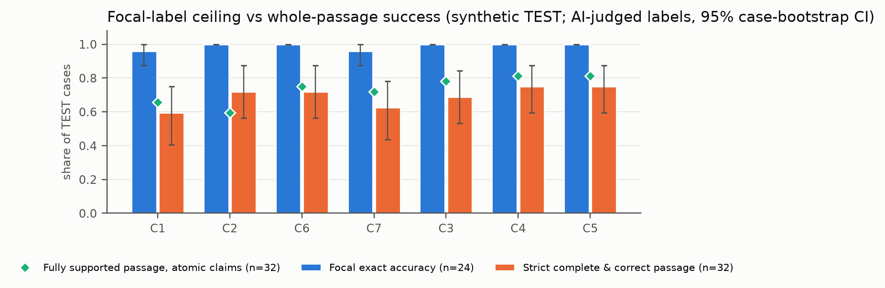
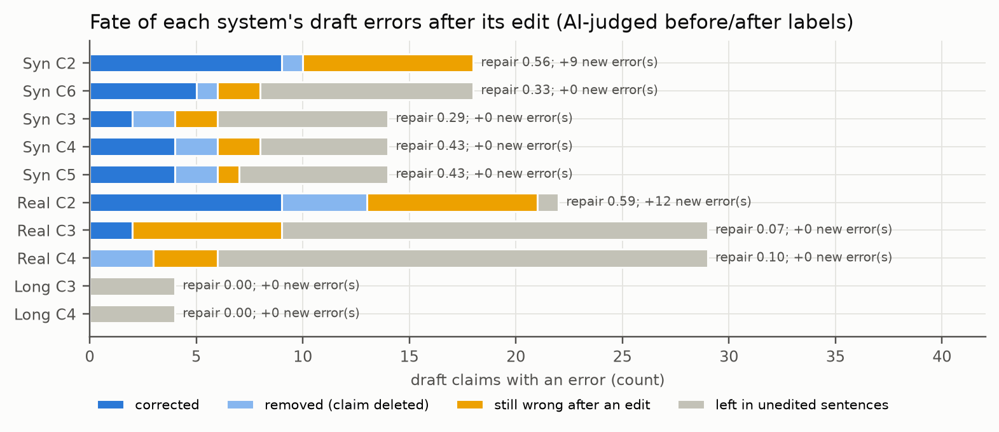

# Saying What the Evidence Shows: Overstatement and Understatement in Agent-Written Results Sections

**DSA4213 Natural Language Processing for Data Science, NUS, Semester 1 AY2026/27, Group 5**
Li Jiajun, Xiao Xinkai, Liu Yuxin, Lai Zheyuan

*Final report, 18 October 2026. Repository: `zheyuanlai/DSA4213-project` (private).*

> **How to read this report.** The planned blind human annotation was **not carried out**. Every quality label in
> this report was produced by AI models (§5), and every agreement figure is AI–AI consistency, not human
> inter-annotator reliability. The evidence-level metrics (§5.2) were designed after the frozen evaluation and are
> exploratory. Numeric correctness is checked by deterministic code. Cost, tool-call and latency figures are automatic
> measurements from run logs. The student contribution shares in §11 must be completed and confirmed by all four
> students before submission.

## Abstract

LLM agents are increasingly asked to draft the Results section of a paper from finished experiments. Such text can
overstate the evidence ("significantly better" with no test, "consistently" from four wins out of five) or, after a
cautious check, understate it. We built a 48-case synthetic benchmark of research packages with gold evidence-strength
labels, 12 real-paper packages from CC-licensed arXiv papers and 8 long distractor-heavy packages. On these we compared seven
systems that share one backbone (DeepSeek V4 Flash): direct generation, a generic writer–reviewer loop, and five
ablations of a claim-by-claim verifier that checks each sentence with four deterministic evidence tools and may accept,
weaken, strengthen, remove or flag it. The pre-registered focal metric saturated: five of seven systems labelled every
focal claim correctly. We therefore scored whole passages under AI judging: 1,591 atomic claims judged by two AI model
families with AI adjudication, 2,618 numbers checked by deterministic code, coverage of each paper's important findings,
and every verifier edit. The full agent (C4) does better than direct generation on synthetic passages, but it does **not** outperform the
writer–reviewer loop in claim accuracy or passage-level success, and it keeps fewer of the required numbers (numeric
recall −0.109, 95% CI [−0.185, −0.033]). Its one advantage, more negative findings reported on real papers, comes from
its outline step, not from verification. The verifier **never chose to strengthen a claim** (0 of 406 verified TEST claims), so the
bidirectional hypothesis could not be tested. Verification rarely damaged correct claims, but it left most errors in
place: it repaired 29–43% of draft errors on synthetic cases and 7–10% on real papers. Real-paper passages have two
to three times the synthetic claim error rate and report under half of the important findings. Adaptive tool selection
matched scripted checking at lower cost (−3.66 tool calls per case). The conclusions about C4 versus the baselines hold
under each judge alone, a repeated adjudication and a 2-of-3 vote with a third judge family; finer rankings do not.

## 1. Introduction

Research agents can now run experiments and write the paper about them [5, 6, 8–10, 12]. The Results section is
where the evidence meets the prose, and it is where an LLM writer is most tempted to round up: a mean difference
becomes "significant", three seeds become "robust", a win on four of five datasets becomes "consistent". Systems that
gate claims against evidence exist [1, 8, 9, 12], but the ones we read check only one direction, against
overstatement. A checker that is too cautious creates the opposite error: it weakens or removes conclusions the
evidence fully supports, an effect reported for an explicit calibration policy in a briefing pilot [2].

**Research question.** Does claim-by-claim, tool-grounded evidence verification calibrate the strength of claims in
agent-written Results passages, reducing overstatement without creating excessive understatement, compared with
direct generation and a generic writer–reviewer loop, under controlled inference and revision budgets?

**Pre-registered hypotheses** (`docs/PROTOCOL_FREEZE.md`):

* **H1.** The full agent (C4) against the writer–reviewer loop (C2) and direct generation (C1): overstatement,
  calibration accuracy, coverage and cost. We expected C4 to be better calibrated at comparable coverage.
* **H2.** C4 against the same verifier without STRENGTHEN (C5, identical drafts): understatement on the 12
  strong-evidence cases, corrected vs introduced edits, and any overstatement trade-off.
* **H3.** Adaptive tool selection (C4) against scripted fixed-order checking (C3): calibration and coverage, tool calls,
  latency and cost.

**What we found.** The answer to the research question is mostly negative. Verification helps against direct
generation and against its own draft on synthetic cases. It does not beat a simple writer–reviewer loop. It never
strengthens a claim. On real papers it barely changes the text. The one clear positive result is efficiency
(H3). Section 7 lists the negative findings together, because they are the main results of the project.

## 2. Related work

All sources were checked against arXiv, the ACL Anthology or the proceedings
(`docs/RELATED_WORK_VERIFICATION.md`; BibTeX in `report/references_verified.bib`). Several close comparators are 2026
preprints; we report their numbers as stated by the authors.

**Evidence-gated scientific writing.** Provenance Before Prose [1] locks the strength of statistical claims to their
provenance and only ever downgrades. Spark-to-Paper [8] admits claims with narrow, weaken or remove actions, EviGraph
[9] gates claims on an evidence graph, and ResearchLoop [12] is an evidence-gated control plane for research claims.
CalBrief [2] is closest to our concern about understatement: in a 16-package pilot, an explicit strength-calibration policy
downgraded 59 of the 61 takeaways whose verified label was "moderate". To our knowledge, the agentic gating systems
above evaluate or enforce only the overstatement direction. Our study measures both directions in agent-written
Results passages with matched-pair cases and an explicit STRENGTHEN ablation.

**Exaggeration and claim strength.** RIGOURATE [3] scores exaggeration in papers against evidence. In science
communication, Yu et al. [14] measure correlation-to-causation exaggeration and Wright and Augenstein [13] label press
releases as undersell, accurate or exaggerate. **We therefore do not claim to be the first to study understatement.**

**Claim–evidence reasoning and critique.** CLAIM-BENCH [4] and CLAIMCHECK [7] show that LLMs struggle to link claims
to the evidence in papers and to ground their critiques. SciTrue [11] is a demonstration system for evidence-grounded
claim verification.

**Research agents.** The AI Scientist [5, 6] and Agent Laboratory [10] write full papers. The AI Scientist's own case study notes
positive interpretation of results, and Agent Laboratory reports that automated reviewers overrate quality.

**Self-refinement and evaluation.** Self-Refine [15] revises with self-generated feedback; CRITIC [16] shows that
tool-interactive critique corrects more reliably than self-critique alone. Our C2 is a Self-Refine-style baseline and
our verifier is a CRITIC-style tool loop. FActScore [17] motivated our atomic-claim evaluation.

## 3. Benchmark and data

**Synthetic benchmark** (`docs/BENCHMARK_SPEC.md`). We wrote 48 original research packages: 8 categories × 6 cases, split into 16 DEV and 32
TEST cases and built as 24 matched pairs. The two cases in a pair differ in one evidence fact that changes what may be
claimed. A package contains the research question, setup, exact results tables, statistical-test metadata and quoted
cited passages. Six **ordinal** categories (statistical significance, robustness, generalisation, consistency,
efficiency, citation support) have a gold focal level ℓ ∈ {0, 1, 2}. The 24 ordinal TEST cases have 12 strong,
6 ℓ = 1 and 6 ℓ = 0 cases. Two further categories, numerical reporting (NUM) and negative results (NEG), have their own
gold: required numeric facts and required negative findings. TEST gold is kept outside the repository, and its hash
is frozen in `benchmarks/freeze_manifest.json`.

**Real papers** (`data/real_papers/`). There are 12 packages from arXiv papers under CC BY 4.0 or CC BY-SA 4.0. In each,
the proposed method is renamed, one or two tables are transcribed, and the authors' own Results and Discussion are
withheld. There is no gold. **Long packages** (`docs/DIAGNOSTIC_LONG_PACKAGES.md`) are 8 synthetic cases with 3–5
tables and irrelevant distractor passages. They were written after the DEV pilots, so they are a stress test, not
held-out validation.

## 4. Systems

All conditions run through one pipeline (`src/conditions.py`) with one pinned backbone,
`deepseek/deepseek-v4-flash-0731`, at temperature 0 with reasoning off (`docs/MODEL_SELECTION.md`). Writers return a
JSON list of sentences, and each sentence is one claim (at most 6 verified per passage).

| | Condition | Starts from | Post-draft step |
|---|---|---|---|
| C1 | Direct generation | direct draft | none |
| C2 | Writer–reviewer loop | direct draft | generic critique, then revision |
| C3 | Scripted verifier | outline draft | four tool checks in a **fixed** order per claim (STRENGTHEN allowed) |
| C4 | Full agent | outline draft | **adaptive** tool checks per claim (STRENGTHEN allowed) |
| C5 | No strengthening | outline draft | adaptive checks, STRENGTHEN **disabled** |
| C6 | No outline | direct draft | adaptive checks (STRENGTHEN allowed) |
| C7 | Outline only | outline draft | none |

**Shared drafts.** C3, C4, C5 and C7 start from the identical outline and draft for each case, and C1, C2 and C6 from the identical direct
draft. C4 vs C5 therefore isolates STRENGTHEN, C4 vs C3 isolates adaptive tool choice, and C4 vs C7 isolates
verification. The paired analysis accounts for this dependence.

**Verifier.** The verifier sees the question, method and setup and an index of the evidence (table schemas and passage list)
**without the values**. It can obtain evidence only through four deterministic tools: `lookup_table`,
`get_test_metadata`, `retrieve_passage` and `compare_numbers`. It may make up to 4 evidence-tool calls per claim, then
issues one decision: ACCEPT, WEAKEN, STRENGTHEN, REMOVE or FLAG. FLAG keeps the sentence and records a flag; REMOVE
drops it; WEAKEN and STRENGTHEN replace it. Every call passes through a cost guard with a hard cap, per-stage caps
and an append-only ledger (`src/cost_guard.py`).

## 5. Evaluation

### 5.1 The pre-registered metric and its ceiling

The frozen protocol scores the evidence-strength level expressed by each passage's focal claim against gold, along with
overstatement, understatement, finding coverage, unsupported claims and numeric errors. It planned blind annotation by
four students in two pairs. The students did not carry out that annotation. Instead, four blinded AI annotator roles
labelled the same packets with evidence-based adjudication (`docs/AI_ANNOTATION_RESULTS.md`). On the 24 ordinal TEST
cases, focal exact accuracy is **1.000 for C2–C6 and 0.958 for C1 and C7**, with no understatement in any condition.
A metric on which five of seven systems are perfect cannot rank them. The tutor raised the same point before this
result: the focal metric judges one or two sentences of a short synthetic case.

### 5.2 Evidence-level evaluation (post-freeze, exploratory)

We therefore scored **whole passages** (`docs/EVALUATION_EXTENSION_PROTOCOL.md`). The protocol was committed before any annotation
call, and every later change is listed in its dated amendment log (§11, amendments 1–12). No new backbone inference was run: all 224 synthetic TEST,
46 real-paper and 24 long-package outputs were scored as they were.

| Metric | Definition |
|---|---|
| Strict complete-and-correct passage | 1 only if the focal level is correct, every required finding is covered, there is no unsupported claim or numeric error, all NUM facts and NEG findings are reported, and the run completed |
| Atomic claim support rate | SUPPORTED / assessable atomic claims (each sentence decomposed into atomic propositions) |
| Atomic factual error rate | claims not entailed, contradicted or with a wrong number / assessable claims |
| Fully supported passage | at least one assessable claim, and all of them supported |
| Numeric precision / recall | correct numeric assertions / numeric assertions; required numeric facts stated correctly / required facts |
| Finding recall (real, long) | checklist findings reported correctly / checklist findings; separately for core and negative/null findings |
| Repair recall, new errors, harmful-edit rate | for each verified system against its own draft: draft errors corrected or removed; errors introduced; harmful / substantive edits |
| Efficiency | cost, latency and tool calls from run logs; cost per correct passage; repairs per 100 tool calls |

### 5.3 AI judging protocol

* **Blinding.** Judges saw only packets containing the package, opaque passage labels and sentence IDs. A leakage check refused
  any prompt containing condition names, run tags, case IDs, private paths or gold text. The output-to-condition
  mapping never left `private/`.
* **Claims and checklists.** GPT-5.6 (Codex CLI, reasoning high) extracted atomic claims and mapped every number to evidence cells.
  For real and long packages, GPT-5.6 also built a reference checklist of findings from the package alone, Claude Sonnet 5.5
  reviewed it, and the checklist was frozen before any coverage judgement.
* **Two judge families.** Judge A (GPT-5.6) and Judge B (Claude Haiku 5.5 for synthetic verification and edit alignment;
  Claude Sonnet 5.5 for real and long packages and for coverage) labelled every claim independently as SUPPORTED,
  OVERSTATED, UNDERSTATED, UNSUPPORTED or CONTRADICTED. They also judged finding coverage and aligned draft and final claims.
* **Adjudication.** GPT-5.6, in a separate role and blind to which judge wrote which reading, resolved 204 claim,
  82 coverage and 84 alignment disputes. After adjudication, no claim was unresolved and one was excluded.
* **Numbers by code.** A deterministic checker recomputed every asserted number from the mapped evidence cells. It
  allows a tolerance derived from the stated rounding and detects misattribution and arithmetic errors. Of 2,618
  numbers, 30 were not checkable, for example implicit counts.
* **Statistics.** We use a paired bootstrap over cases (papers for the real set), 10,000 resamples, seed 4213. Claim-pooled rates are bootstrapped as
  ratios of sums. An interval from identical labels in every paired unit is reported as *degenerate*. No multiplicity
  correction is applied, and nothing is called "significant".

**Agreement before adjudication** (AI–AI): claim label 94.1% (κ 0.56) synthetic, 91.8% (κ 0.65) real; finding coverage
73.5% (κ 0.59) on real papers, the weakest judgement. The adjudicator shares Judge A's model family, so §6.7 checks
every headline contrast without it.

### 5.4 Deviations from the proposal

| Deviation | Consequence |
|---|---|
| No human annotation; AI annotation instead (2026-10-18) | Every quality label is an AI judgement. This is a material deviation and must not be reported as human evaluation. |
| Evidence-level metrics added after the frozen evaluation and after the first AI results | They are exploratory, not pre-registered. Checker defects found while inspecting disputes were fixed before the consensus was frozen (protocol §11.7). Two scoring rules were refined after the first scoring and applied to every condition (§11.9). |
| Adjudicator test–retest and a third judge family added (protocol amendments 11–12, written before the calls) | These are supplementary robustness analyses (§6.7). The primary results are unchanged. |
| Real-paper and long-package runs used higher generation token limits (`configs/amended_secondary.yaml`) | The frozen 700-token limit truncated outlines on long packages. The amended run covers all papers and conditions, and synthetic TEST outputs are unaffected. RP-02 still failed for C3/C4. |
| 4 evidence-tool calls per claim instead of the proposed 3 | Lets the scripted verifier run each tool once, so the H3 comparison is fair |
| Shared upstream drafts across conditions | Gives exact counterfactual contrasts, at the cost of dependence between conditions |

The full list, with timestamps, is in `docs/DEVIATIONS_FROM_PROPOSAL.md`.

## 6. Results

### 6.1 Main results

The main comparison is between C1–C4. The C5–C7 ablations, the long-package stress test and the judge analyses are
supplementary (`docs/EVALUATION_EXTENSION_RESULTS.md`). The table below is generated by
`evaluation/extended_report.py` as `results/ai_extended/tables/main_table.md`.

| Synthetic TEST (32 cases) | C1 direct | C2 writer–reviewer | C3 scripted verifier | C4 full agent | C4 − C2 [95% CI] |
|---|---|---|---|---|---|
| Focal exact accuracy (24 ordinal cases) | 0.958 | 1.000 | 1.000 | 1.000 | +0.000 [+0.000, +0.000] (degenerate) |
| Strict complete-and-correct passage | 0.594 | 0.719 | 0.688 | 0.750 | +0.031 [−0.094, +0.156] |
| Atomic claim support rate | 0.926 | 0.943 | 0.963 | 0.970 | +0.027 [−0.009, +0.063] |
| Atomic factual error rate | 0.074 | 0.057 | 0.037 | 0.030 | −0.027 [−0.063, +0.009] |
| Fully supported passage | 0.656 | 0.594 | 0.781 | 0.812 | +0.219 [+0.000, +0.438] |
| Numeric precision | 0.982 | 0.984 | 0.991 | 0.994 | +0.010 [−0.008, +0.032] |
| Numeric recall (64 required facts) | 0.828 | 0.828 | 0.719 | 0.719 | −0.109 [−0.185, −0.033] |
| Cost per passage (USD) | 0.00023 | 0.00068 | 0.00241 | 0.00209 | — |
| Evidence-tool calls per passage | 0.0 | 0.0 | 12.9 | 9.2 | — |

| Real papers (12; C3/C4 completed on 11) | C1 direct | C2 writer–reviewer | C3 scripted verifier | C4 full agent | C4 − C2 [95% CI] |
|---|---|---|---|---|---|
| Atomic claim support rate | 0.894 | 0.885 | 0.873 | 0.874 | +0.005 [−0.068, +0.086] |
| Atomic factual error rate | 0.096 | 0.100 | 0.122 | 0.116 | +0.002 [−0.074, +0.066] |
| Finding recall (package checklist) | 0.376 | 0.412 | 0.487 | 0.474 | +0.077 [−0.045, +0.200] |
| Negative/null-finding recall | 0.179 | 0.256 | 0.417 | 0.417 | +0.194 [+0.027, +0.375] |
| Numeric precision | 0.986 | 0.991 | 0.979 | 0.979 | −0.012 [−0.048, +0.019] |
| Numeric recall (checklist facts) | 0.215 | 0.237 | 0.224 | 0.224 | −0.035 [−0.102, +0.025] |
| Cost per passage (USD) | 0.00041 | 0.00115 | 0.00431 | 0.00385 | — |

All labels in both tables are AI judgements, except numeric verdicts, which come from deterministic checks of AI
evidence mappings. Rates pool claims or findings over cases, and intervals are paired case (paper) bootstraps.



*Figure 1. Focal accuracy is flat across conditions. Strict whole-passage success spreads them over 0.59–0.75.*

### 6.2 H1: the full agent against the baselines

* **Against direct generation (C1)**, C4 is better on strict passage success, +0.156 [0.000, +0.312], with a lower bound
  at zero. On atomic support it is better by +0.044 [−0.001, +0.093] under the adjudicated consensus. Under each judge alone
  the gain is clearly positive: +0.063 [+0.018, +0.107] under Judge A and +0.056 [+0.010, +0.107] under Judge B.
* **Against the writer–reviewer loop (C2), C4 does not outperform.** On synthetic cases every quality interval includes
  zero; the largest difference, fully supported passages, is +0.219 [0.000, +0.438]. C4 is worse on
  numeric recall: −0.109 [−0.185, −0.033]. The outline-based lineage (C7/C3/C4/C5) states more numbers per passage
  but fewer of the required ones, and verification does not change this (C4 − C7 numeric recall is degenerate at 0).
  Under a 2-of-3 majority of three AI judge families, the C4 − C2 support difference is −0.004 [−0.048, +0.036].
* **On real papers**, C4 is not better than C1 or C2 in support or numeric recall. Its higher negative/null-finding recall
  (+0.194 against C2) comes from the shared outline step. The unverified outline draft has the same 0.417, and C4 minus
  the draft is degenerate at 0.

H1 is therefore **not supported** against the stronger baseline. Against direct generation, the support is weak and
depends on the metric.

### 6.3 H2: strengthening never occurred (negative)

No verifier chose STRENGTHEN in any run: 0 of 406 verified TEST claims across C3–C6, 0 of 86 real-paper claims and
0 of 64 long-package claims. C4 and C5 are indistinguishable on every metric, and most of their intervals are degenerate.
Understatement is nearly absent from synthetic outputs (0–1 claims per condition), so there was little to repair.

A supplementary DEV-only diagnostic (`docs/H2_DIAGNOSTIC.md`) gave the verifier six deliberately understated drafts.
It accepted all six unchanged, in both C4 and C5. The traces show two failure modes:

1. The verifier checks the evidence that a sentence *refers to*, so it often never retrieved the evidence that would support a
   stronger claim.
2. When it did retrieve that evidence, it still accepted the weaker claim. In one case it wrote "'Most of the six' is
   supported (indeed all six)" and then chose ACCEPT.

Allowing STRENGTHEN as an action was not enough to produce bidirectional calibration. The absence of wrong
strengthening is not evidence of calibration either: a verifier that never strengthens cannot strengthen wrongly.

### 6.4 H3: adaptive vs scripted verification (efficiency)

C4 matches or slightly exceeds C3 on every quality metric:

* strict success +0.062 [0.000, +0.156];
* support +0.007 [0.000, +0.019];
* repairs per case +0.062 [0.000, +0.156].

It is also cheaper: 9.22 vs 12.88 evidence-tool calls per synthetic case (−3.66 [−4.19, −3.16]), 34.7 vs 38.7 s
latency and $0.00209 vs $0.00241 per case (`docs/AUTOMATIC_RESULTS.md`). On real papers it uses 3.27 fewer tool calls per paper, and
on long packages 9.4 vs 16.0. H3 is supported as an **efficiency** result, not as evidence of better correctness.

### 6.5 What the verifier actually does to a draft



*Figure 2. What happened to each draft error after the post-draft step, by system.*

| Each system vs its own draft | Draft errors | Corrected or removed | Left in unedited sentences | New errors | Repair recall |
|---|---|---|---|---|---|
| Synthetic C2 (generic reviser) | 18 | 10 | 0 | 9 | 0.56 |
| Synthetic C3 (scripted) | 14 | 4 | 8 | 0 | 0.29 |
| Synthetic C4 (adaptive) | 14 | 6 | 6 | 0 | 0.43 |
| Real C2 | 22 | 13 | 1 | 12 | 0.59 |
| Real C3 | 29 | 2 | 20 | 0 | 0.07 |
| Real C4 | 29 | 3 | 23 | 0 | 0.10 |
| Long C3 / C4 | 4 | 0 | 4 | 0 | 0.00 |

* **Few harmful error transitions were detected, but many errors remained unresolved.** The judges found no verifier
  edit that turned a correct claim into an error. However, most draft errors survive, mainly in sentences the verifier
  ACCEPTed unchanged. Several edits replaced one wrong claim with another. For example, a misreported gain range was
  rewritten with a new endpoint taken from the wrong dataset (34.1 − 29.7 = 4.4, stated as 3.8). Another passage turned an
  overstated summary into four per-benchmark claims, three of which the judges still labelled overstated.
* **Retrieval is not the main bottleneck.** For almost every erroneous draft claim it checked, the verifier retrieved
  at least one evidence item the judges cited (all on synthetic cases; 93% for C3 and 100% for C4 on real papers).
  The failure is mostly in the accept decision.
* **Unnecessary weakening is common among WEAKEN edits.** Half of the verifiers' WEAKEN rewrites changed claims that
  were already correct (2 of 4 per synthetic system; 7 of 14 for real-paper C3). For example,
  "substantially lower p99 latency (610 vs 1,240 ms)" became "lower p99 latency". None of these produced an error.
* **The generic reviser repairs more but also breaks more.** C2's net effect on support is close to zero: +0.017 on
  synthetic cases and −0.009 on real papers.

### 6.6 Real papers and long packages

Real-paper passages contain about 18 claims each, against about 8 for synthetic passages. Their claim error rate is 0.10–0.13,
against 0.03–0.07, and only 9–25% of them are fully supported, against 59–81%. Every system reports under half of the
checklist findings and about a fifth of the checklist's headline numbers. Understatement appears here and is highest for the generic
reviser (C4 − C2 understatement rate −0.030 [−0.058, −0.007]). On real papers, C1 is the cheapest and has the
highest support rate. C3 and C4 buy higher finding recall at about 9–11 times the cost. Per-text finding recall correlates
positively with atomic support (ρ = 0.49) and with an earlier AI readability score (ρ = 0.54). More complete
passages were therefore not less accurate or less readable.

On the 8 long packages, verification changed one sentence per system. It repaired none of the 4 draft errors and left every
quality metric identical to the unverified draft. The only difference was cost.

### 6.7 Robustness to the AI judge

Because every label is an AI judgement and the adjudicator shares Judge A's model family, we ran three checks.

1. **Each judge alone** (§6 of the results document). The synthetic verification effect (C4 − C7) and the outline
   lineage's negative-finding advantage hold under either judge. The real-paper C4 − C2 differences in support and
   finding recall change sign with the judge.
2. **Adjudicator test–retest** (results document §10; protocol amendment 11). The adjudicator was re-asked every adjudication prompt verbatim.
   It reproduced 81% of synthetic and 90% of real-paper label decisions, but only **69% of real-paper coverage
   decisions**. No planned contrast changed sign (0 of 126). Per-system repair rates moved: shared-draft errors fell
   from 14 to 11, and C3's repair recall from 0.29 to 0.18.
3. **Third judge family and 2-of-3 majority** (results document §11; protocol amendment 12). Qwen 3.7 Plus re-verified all 1,591 claims for
   $0.51. Agreement among the three families is moderate: Fleiss κ 0.52 on synthetic and 0.42 on real papers. Under a
   2-of-3 majority vote of the three judges, C4 − C1 (+0.055 [+0.013, +0.097]) and C4 − C7 (+0.026 [+0.004, +0.054])
   stay positive, C4 − C2 becomes −0.004 [−0.048, +0.036], and the generic reviser's gain over direct generation
   becomes clearly positive (+0.059 [+0.016, +0.110]). The majority falls back on the adjudicated decision when the three
   judges all disagree, so it is not fully independent of the adjudicator. Excluding those items instead gives the same
   conclusions (C4 − C2 −0.004 [−0.048, +0.036]; real C4 − C2 −0.004 [−0.073, +0.069]).

**What holds under every reading:**

* C4 beats direct generation on synthetic support.
* Verification improves on its own synthetic draft.
* C4 and C3 are equivalent up to a small margin, and C4 and C5 are identical.
* C4 has lower numeric recall than C2.
* No real-paper contrast of C4 with C1 or C2 excludes zero.

**What does not hold:** the ranking of C2 against C1 and C4 on synthetic support, and every real-paper passage-level
comparison. Both depend on how borderline magnitude wording is judged.

## 7. Negative findings

We list these together because they are the project's main empirical results.

1. **The full agent does not beat a generic writer–reviewer loop.** No claim-accuracy or passage-level metric favours
   C4 over C2 with an interval excluding zero, and under a three-judge majority the support difference is −0.004. The
   one metric that does favour C4, negative-finding recall on real papers, is inherited from its unverified outline draft.
2. **Strengthening never happened.** The verifier chose STRENGTHEN 0 times in 406 TEST claims, 0 times on real and
   long packages, and 0 of 6 times in a targeted diagnostic. H2 is untested, and the system is in practice a
   one-directional overstatement and number checker.
3. **Verification leaves most errors in place.** It repairs 29–43% of synthetic draft errors, 7–10% of real-paper
   errors and none of the long-package errors. Most surviving errors sit in sentences the verifier explicitly
   ACCEPTed after retrieving relevant evidence.
4. **The outline pipeline loses required numbers.** Numeric recall falls by 0.109 against the direct-draft lineage, and
   verification does not recover it.
5. **The pre-registered metric was uninformative.** Five of seven systems were perfect on focal accuracy. The synthetic
   benchmark is too easy to separate systems on error rates. Real papers are where the residual errors are.
6. **The AI evaluation is itself uncertain.** Three judge families agree only moderately, and a single adjudicator
   changed 31% of its real-paper coverage decisions on an identical re-ask.

## 8. Limitations

* **No human annotation or validation.** All calibration, claim, coverage and edit labels come from AI models. Judges from three
  families were used, but their errors may be correlated with each other and with the extractor's and adjudicator's. The adjudicator shares one judge's family.
  The labels are not human judgements, and AI–AI agreement is not inter-annotator reliability.
* **Post-freeze, exploratory metrics.** The evidence-level evaluation was designed after the frozen evaluation and after the first AI results.
  Checker and scoring refinements are documented in the protocol's amendment log.
* **Small samples.** The synthetic TEST set has 32 cases (24 ordinal, 4 NUM, 4 NEG). There are 11–12 real papers and 8 long cases. Many contrasts rest on a handful of
  discordant cases, and most intervals include zero.
* **Real-paper references are AI-built.** Real-paper checklists and headline numbers were built by AI from the packages. Compound findings make
  recall strict, and recall depends on which numbers the builder chose. RP-02 has no C3/C4 output.
* **One backbone.** Only DeepSeek V4 Flash was evaluated, with reasoning off. Stronger or reasoning models may behave differently.
* **Author-designed cases.** The synthetic cases were written by the project, and their traps may be learnable. The long packages were written after
  the DEV pilots.
* **Partial unblinding.** Quoting TEST edit examples unblinds those texts for any future human audit.

## 9. Conclusion

Tool-grounded, claim-by-claim verification made agent-written Results passages slightly more accurate than direct
generation and than the verifier's own drafts on synthetic cases. It did so cheaply when tools were chosen adaptively.
It did not outperform a generic writer–reviewer loop. It never strengthened an understated claim. It repaired only a
minority of errors, and almost none on real papers. The main obstacle is the decision step: the verifier retrieves
the right evidence and then accepts the claim anyway. Future work should check that decision directly, for example by
requiring an explicit comparison between the claim and the evidence before ACCEPT. It should also test the agent on
real papers with human-validated references and with a backbone that reasons.

## 10. Cost, ethics and AI use

**Spend.** OpenRouter: $1.22 in total, reconciled with OpenRouter's own counter. Of this, $0.71 was for all experiments,
including DEV pilots and diagnostics, and $0.51 for the third AI judge. The Claude CLI judges were metered at list
price ($5.22). The Codex CLI ran on a ChatGPT subscription with no per-call charge.

**Data.** Real-paper excerpts are used under their CC licences (`data/real_papers/README.md`). No personal data is
involved. API keys were read only from the environment or from a file outside the repository. A secret scan of the
tree and full history passes (`scripts/security_check.py`).

**Risks.** Over-trusting automatic verification is a real risk. In our data the verifier accepted most erroneous claims,
so a "verified" label would give false assurance. Lexical proxies (`[PROXY]` in `docs/AUTOMATIC_RESULTS.md`) are
unvalidated and must not be cited as calibration accuracy.

**AI use.** Claude Code (Anthropic) implemented the code, drafted the synthetic cases, extracted the real-paper packages
and drafted the documentation and this report under the coordinator's direction. The evaluated model is DeepSeek V4 Flash
via OpenRouter. The evaluation labels came from these AI roles:

* Codex agents for the multi-agent focal annotation;
* GPT-5.6 (Codex CLI) and Claude Sonnet 5.5 / Haiku 5.5 (Claude CLI) as judges, with GPT-5.6 as adjudicator;
* Qwen 3.7 Plus (OpenRouter) as a third judge.

AI assistants are not group members, and their work is not student contribution. One commit from 2026-10-15 (`70de390`)
carries an AI co-author trailer. We left the history as it is rather than rewrite published commits.

## 11. Contributions

**TO BE COMPLETED AND CONFIRMED BY ALL FOUR STUDENTS BEFORE SUBMISSION. Shares must sum to 100%.** The planned roles below
come from the proposal and are not a record of the work actually done.

| Student | Planned role (proposal) | Actual contribution | Share |
|---|---|---|---|
| Li Jiajun | Benchmark and annotation protocol | *to be written by the student* | __ % |
| Xiao Xinkai | Evidence store, tools and real-paper packages | *to be written by the student* | __ % |
| Liu Yuxin | Writer, verifier and baselines | *to be written by the student* | __ % |
| Lai Zheyuan | Coordination, evaluation and report | *to be written by the student* | __ % |

## References

[1] X. Fan et al. 2026. Provenance Before Prose: Claim-Locked Reporting for Statistical Text Generation. arXiv:2608.25336.

[2] Y. Fu, Y. Kang, Y. Zhao. 2026. CalBrief: A Pilot Diagnostic Benchmark for Evidence-Calibrated Scientific Briefing with Large Language Models. arXiv:2606.27383.

[3] J. James et al. 2026. RIGOURATE: Quantifying Scientific Exaggeration with Evidence-Aligned Claim Evaluation. In *Findings of ACL 2026*, pp. 34022–34043.

[4] S. R. Javaji et al. 2025. Can AI Validate Science? Benchmarking LLMs on Claim→Evidence Reasoning in AI Papers. In *Proc. IJCNLP-AACL 2025*, pp. 2355–2379.

[5] C. Lu et al. 2024. The AI Scientist: Towards Fully Automated Open-Ended Scientific Discovery. arXiv:2408.06292.

[6] C. Lu et al. 2026. Towards end-to-end automation of AI research. *Nature*, pp. 914–919.

[7] J. Ou et al. 2025. CLAIMCHECK: How Grounded are LLM Critiques of Scientific Papers? In *Findings of EMNLP 2025*, pp. 21712–21735.

[8] Z. Qian et al. 2026. Spark-to-Paper: End-to-End Research Paper Generation as a Composable Skill. arXiv:2608.11924.

[9] Z. Ren et al. 2026. EviGraph: Evidence-Guided Autonomous Research Agents. arXiv:2608.04738.

[10] S. Schmidgall et al. 2025. Agent Laboratory: Using LLM Agents as Research Assistants. In *Findings of EMNLP 2025*, pp. 5977–6043.

[11] N. Tan, M. Li, M. Gahegan. 2026. SciTrue: Evidence-Grounded Claim Verification in Science. In *Proc. EACL 2026 (Volume 3: System Demonstrations)*, pp. 397–406.

[12] Y. Xia, T. Wang. 2026. ResearchLoop: An Evidence-Gated Control Plane for AI-Assisted Research. Technical report, arXiv:2605.28282.

[13] D. Wright, I. Augenstein. 2021. Semi-Supervised Exaggeration Detection of Health Science Press Releases. In *Proc. EMNLP 2021*, pp. 10824–10836.

[14] B. Yu, J. Wang, L. Guo, Y. Li. 2020. Measuring Correlation-to-Causation Exaggeration in Press Releases. In *Proc. COLING 2020*, pp. 4860–4872.

[15] A. Madaan et al. 2023. Self-Refine: Iterative Refinement with Self-Feedback. In *NeurIPS 36*, pp. 46534–46594.

[16] Z. Gou et al. 2024. CRITIC: Large Language Models Can Self-Correct with Tool-Interactive Critiquing. In *ICLR 2024*.

[17] S. Min et al. 2023. FActScore: Fine-grained Atomic Evaluation of Factual Precision in Long Form Text Generation. In *Proc. EMNLP 2023*, pp. 12076–12100.

## Appendix A. Supplementary material

| Topic | Where |
|---|---|
| All seven conditions on every metric, contrasts, figures | `docs/EVALUATION_EXTENSION_RESULTS.md`, `results/ai_extended/` |
| Judge sensitivity, adjudicator test–retest, third judge | same document, §6, §10, §11 |
| Multi-agent AI focal annotation | `docs/AI_ANNOTATION_RESULTS.md`, `results/ai_scored/` |
| Automatic metrics: completion, cost, latency, tool trajectories, `[PROXY]` levels | `docs/AUTOMATIC_RESULTS.md`, `results/automatic/` |
| H2 diagnostic | `docs/H2_DIAGNOSTIC.md` |
| Long-package diagnostic design | `docs/DIAGNOSTIC_LONG_PACKAGES.md` |
| Protocols and deviations | `docs/PROTOCOL_FREEZE.md`, `docs/EVALUATION_EXTENSION_PROTOCOL.md`, `docs/DEVIATIONS_FROM_PROPOSAL.md` |

## Appendix B. Reproducing the numbers

`docs/REPRODUCIBILITY.md` gives the full procedure. In short:

```bash
pip install -r requirements.txt
python -m pytest -q                        # offline tests, no API calls
python scripts/verify_artifacts.py         # frozen inputs, annotations and manifests are intact
python scripts/run_extended_evaluation.py report    # tables and figures from the frozen consensus
```

Every judge call is cached by input hash, so re-running the evaluation reproduces the frozen labels without new
calls. Re-scoring by condition needs the coordinator-private mapping in `private/`.
